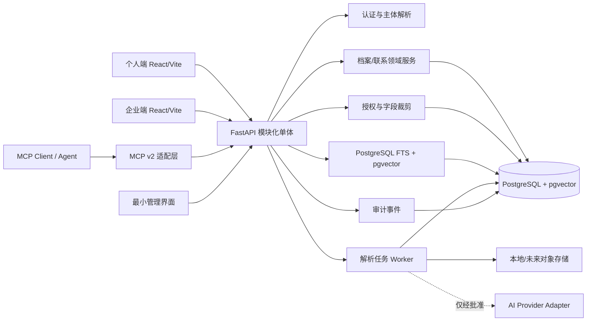
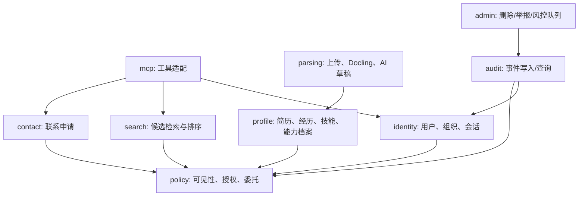
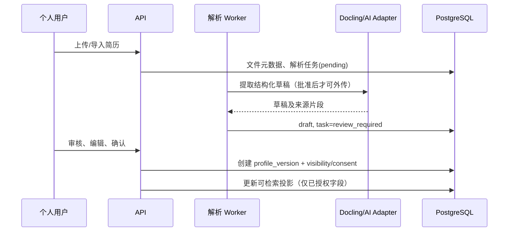
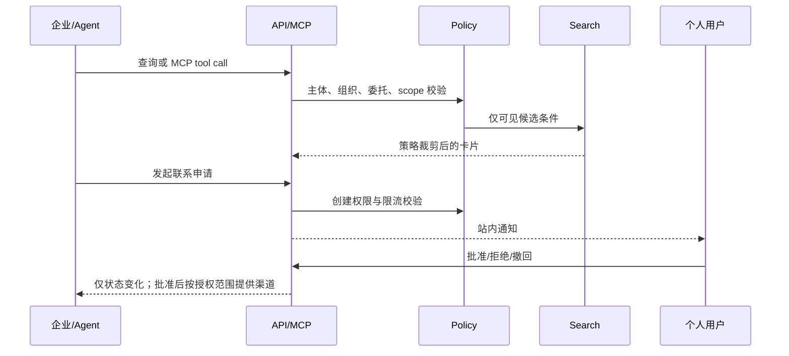

# HHBA V0.1 系统架构

状态：规划待审查。采用模块化单体；所有端口共享同一个 API、策略执行点与 PostgreSQL 数据库。

## 架构原则

1. **服务端为唯一策略执行点**：UI、REST 与 MCP 均不能绕过访问控制。
2. **最小数据返回**：查询结果先选候选，再按主体、组织、委托和资源策略过滤、裁剪。
3. **异步解析，人工确认发布**：上传不等于公开，解析不等于档案更新。
4. **可替换 AI**：以 Provider Adapter 处理模型，默认关闭外部传输。

## 模块依赖

禁止反向依赖：领域模块不得直接调用前端；MCP 不得直连数据库；Worker 不得绕过 Profile/Policy 发布档案。

## 关键流程

### 简历到可检索档案

### 搜索与联系申请

## 可直接复用与仅参考

| 组件 | V0.1 决策 |
|---|---|
| FastAPI、PostgreSQL、pgvector、Docker Compose、Docling、MCP Python SDK v2 | 直接使用已安装/已验证组件 |
| JSON Resume | 作为导入/导出结构参考；扩展置于 `hhba` 命名空间 |
| Reactive Resume v6 | 仅参考交互与数据建模，不嵌入代码或作为基座 |
| Meilisearch、OpenCATS | 不引入；前者在有检索性能证据后评估，后者仅业务流程参考 |

许可证与固定版本见 [DEPENDENCY_LICENSES.md](DEPENDENCY_LICENSES.md)。
